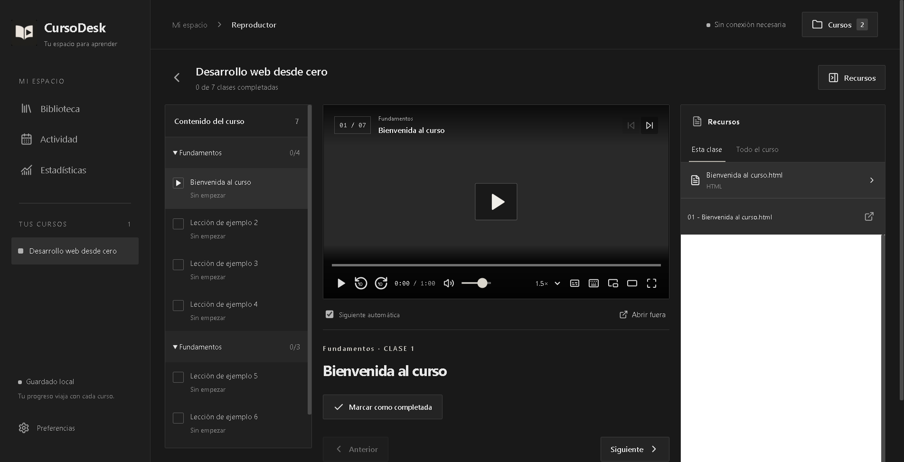

# CursoDesk

Biblioteca de cursos locales para Windows, construida con React y Electron. Guarda el progreso en cada carpeta, sin cuentas ni nube.

**[Descargar instalador](https://github.com/carvajalmauricio/Cursos-Desk/releases/latest)** · [Reportar un problema](https://github.com/carvajalmauricio/Cursos-Desk/issues)



## Empezar

1. Descarga el instalador `.exe` desde Releases y ejecútalo en Windows x64.
2. En **Preferencias**, escribe la ruta de tu carpeta de cursos. Inicialmente se utiliza `Descargas/Telegram Desktop`.
3. Cada subcarpeta con videos es un curso. Abre **Cursos** y marca los que quieras añadir. Las carpetas nuevas aparecen sin marcar.
4. Abre un curso para continuar desde la última posición.

El instalador no tiene firma digital; Windows puede mostrar un aviso de SmartScreen. Comprueba la descarga con `Get-FileHash` y `SHA256SUMS.txt` de la versión.

## Funciones

- Saltos de 10 segundos, búsqueda, volumen, velocidad, subtítulos SRT/VTT, pantalla completa, imagen en imagen y modo cine. Pulsa `?` para ver los atajos.
- Posición guardada y finalización al ver el 90% de los intervalos únicos. Saltar al final no completa una clase; también admite marcado manual.
- Siguiente clase automática, con cuenta atrás cancelable y opción para desactivarla.
- Recursos a la derecha: HTML, PDF, imágenes, texto y Word; apertura con otras aplicaciones.
- Historial por clase y día, estadísticas y avance por curso.
- Detección automática de carpetas. Desactivar conserva el progreso.

Los materiales no cuentan como clases completadas. No hay cuentas, sincronización, notas ni medición del tiempo de estudio.

## Organizar los cursos

```text
Mis cursos/
  Desarrollo web/
    01 - Introducción/
      01 - Bienvenida.mp4
      01 - Bienvenida.html
      02 - Herramientas.mp4
      Recursos Adicionales/
        Guía.pdf
```

La búsqueda es recursiva y el orden numérico. Los materiales con el prefijo de una clase se vinculan a ella; también se muestran recursos de sección y curso. Las carpetas sin videos y los comprimidos no crean cursos.

La compatibilidad depende de Chromium/Electron; MP4 H.264/AAC es una opción adecuada. Puedes abrir otros formatos externamente. Word usa una vista de lectura y puede perder formato; Excel y comprimidos se abren externamente. El visor HTML no ejecuta scripts ni carga conexiones de red, por lo que algunos documentos pueden verse incompletos.

## Datos

El contenido permanece en tu disco. Cada curso activo guarda `.course-player/course.sqlite`: posiciones, intervalos, finalización e historial. Se conserva `course.sqlite.bak`, actualizado como máximo una vez al día. Las preferencias y selección por raíz están en `%APPDATA%/curso-desk/library.sqlite`.

Se guarda periódicamente y al pausar, cambiar de clase o cerrar. Al trasladar un curso copia también `.course-player`. Si renombras la carpeta, vuelve a marcarla. Renombrar o mover videos dentro del curso cambia su identidad; no se migra automáticamente su progreso.

La carpeta debe permitir escritura. Las bases dañadas se conservan y se informa del error. Para restaurar una copia, cierra la aplicación y conserva los archivos antes de sustituir la base por su `.bak`.

## Desarrollo

El repositorio contiene el código; **Releases** contiene instaladores y código de cada versión en ZIP/TAR. No es un paquete de npm. Requisitos: Windows x64 y Node.js 22+.

```powershell
git clone https://github.com/carvajalmauricio/Cursos-Desk.git
cd Cursos-Desk
npm ci
npm start
```

```powershell
npm run build
npm test
npm run test:ui
npm run test:player
npm run test:visual
npm run dist
```

Las pruebas de interfaz necesitan FFmpeg en `PATH` y generan cursos ficticios temporales. No necesitan tus cursos. El instalador se genera en `release/`. `npm run dev` sirve solo el frontend; usa `npm start` para las funciones de Electron.

Variables opcionales: `CURSODESK_ROOT` fija la raíz, `CURSODESK_DATA` aísla los datos, `CURSODESK_TEST=1` desactiva el diálogo de errores en pruebas, `CURSODESK_PACKAGED=1` prueba el ejecutable en `release/win-unpacked/`.

Consulta [CONTRIBUTING.md](CONTRIBUTING.md), [CHANGELOG.md](CHANGELOG.md) y [SECURITY.md](SECURITY.md).

## Licencia

[MIT](LICENSE). Los cursos de los usuarios no forman parte del proyecto. El icono se creó con un modelo de imágenes; el original y prompt están en `assets/`.
